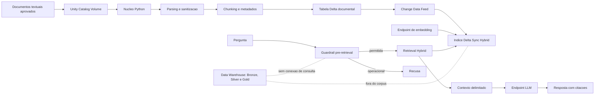

# Implementacao do MVP de RAG Documental no Databricks

## 1. Resumo executivo

Este documento registra a implementacao de um MVP academico de Recuperacao Aumentada por Geracao (RAG) para o projeto LH Nautical. O sistema foi desenhado para responder perguntas sobre documentacao tecnica versionada, sem consultar tabelas operacionais ou retornar valores do Data Warehouse.

O fluxo implementado combina uma etapa local de preparacao documental com recursos do Databricks: Unity Catalog Volume, tabela Delta, Change Data Feed (CDF), indice Delta Sync Hybrid, modelo de embeddings e endpoint de linguagem. A demonstracao remota confirmou o fluxo completo para uma pergunta documental, com resposta em portugues e citacao do arquivo e da secao utilizados.

Sobre esse MVP foram construidas tres camadas adicionais: um Golden Dataset versionado de 30 casos, um avaliador remoto com metricas deterministicas e groundedness por LLM-as-a-judge, e um job de verificacao operacional que tambem prova o isolamento do Data Warehouse. A evolucao esta registrada na secao 39.

O documento separa fatos observados, inferencias e itens pendentes. Nao apresenta credenciais, identificadores privados, URLs internas, dados reais ou valores financeiros. Documentos complementares: [rag_evaluation.md](rag_evaluation.md) para avaliacao, [rag_operacao.md](rag_operacao.md) para operacao e [rag_seguranca.md](rag_seguranca.md) para a politica de menor privilegio.

## 2. Objetivo do projeto

O objetivo e permitir que usuarios consultem, em linguagem natural, a arquitetura, a operacao, a linhagem e as regras documentadas do projeto. O sistema deve recuperar trechos relevantes e produzir uma resposta fundamentada nesses trechos.

O RAG atende ao requisito do checkpoint de demonstrar uma solucao documental no ambiente de dados. A previsao de demanda e os dados numericos do projeto permanecem fora do escopo do RAG.

## 3. Escopo e nao escopo

### Escopo

- Documentos Markdown, README, TXT e HTML de documentacao dbt aprovados.
- Higienizacao e normalizacao do conteudo.
- Divisao em chunks com metadados de origem.
- Persistencia em tabela Delta documental.
- Indexacao com Delta Sync e busca Hybrid.
- Recuperacao de contexto com citacoes.
- Geracao de resposta por endpoint LLM hospedado no Databricks.
- Recusa de perguntas sobre dados operacionais.

### Nao escopo

- Consulta a Bronze, Silver ou Gold.
- Consulta a dados atuais de vendas, estoque, faturamento ou indicadores.
- Geracao de SQL para responder ao usuario.
- Agentes autonomos ou ferramentas de execucao de codigo.
- Dashboard ou aplicacao web.
- Uso de APIs externas para processar o corpus.
- Julgamento automatico de correcao factual: a avaliacao mede fundamentacao e recuperacao, nao substitui revisao humana.

## 4. Requisitos funcionais

1. Ler somente arquivos explicitamente aprovados.
2. Remover conteudo HTML irrelevante antes da indexacao.
3. Preservar arquivo e secao para permitir citacoes.
4. Gerar identificadores estaveis para os chunks.
5. Persistir os chunks em uma tabela Delta documental.
6. Recuperar de tres a cinco trechos por pergunta, com cinco trechos usados na demonstracao.
7. Usar busca semantica e por palavras-chave quando o indice suportar Hybrid.
8. Responder somente quando houver evidencia no contexto.
9. Informar ausencia de evidencia quando necessario.
10. Recusar perguntas que solicitem valores operacionais do Data Warehouse.

## 5. Requisitos de seguranca

A protecao foi implementada em camadas:

1. A allowlist limita os arquivos que podem entrar no corpus.
2. O parser remove scripts, estilos, navegacao, cabecalho e rodape de HTML.
3. Padroes de tokens, senhas, chaves e e-mails sao mascarados.
4. O corpus e persistido em recursos documentais separados.
5. O RAG nao recebe tabelas ou conectores do Data Warehouse.
6. Perguntas numericas e operacionais sao bloqueadas antes do retrieval.
7. Documentos recuperados sao tratados como dados, nao como instrucoes de sistema.
8. O contexto e delimitado por marcadores explicitos.
9. A resposta deve ser sustentada pelo contexto recuperado.
10. A fonte deve ser citada por caminho e secao.
11. A ausencia de evidencia produz uma recusa documental.
12. A autenticacao usa o contexto do ambiente Databricks, sem token no codigo.
13. A identidade de producao devera seguir menor privilegio.

Essas medidas reduzem o risco de injecao e vazamento, mas nao eliminam completamente prompt injection ou outros riscos de um sistema LLM. O controle mais forte para o isolamento do Data Warehouse deve ser a ausencia de privilegios tecnicos na identidade do RAG.

## 6. Arquitetura final

A arquitetura usa os seguintes componentes:

- documentos aprovados versionados;
- Unity Catalog Volume documental;
- nucleo Python de leitura, parsing e sanitizacao;
- chunking e metadados;
- tabela Delta de chunks;
- Change Data Feed;
- indice Delta Sync Hybrid;
- endpoint de embedding gerenciado;
- retrieval com guardrail pre-retrieval;
- endpoint LLM gerenciado;
- resposta com citacoes.

O Data Warehouse fica fora do fluxo e nao existe seta de consulta entre os dois dominios.



## 7. Fluxo end-to-end

### 7.1 Fluxo de ingestao

```text
documentos aprovados
-> Volume
-> leitura
-> parsing
-> sanitizacao
-> separacao por secao
-> chunking
-> metadados e hashes
-> tabela Delta
-> CDF
-> Delta Sync
-> indice Hybrid
```

A ingestao remota foi executada com sucesso por um job isolado e a tabela resultante foi observada com aproximadamente 224 chunks.

### 7.2 Fluxo de consulta

```text
pergunta
-> guardrail deterministico
-> recusa ou retrieval
-> busca Hybrid
-> selecao dos trechos
-> contexto delimitado
-> LLM
-> resposta
-> citacoes
```

Perguntas operacionais devem ser recusadas antes da consulta ao indice. A validacao automatizada da resposta e das citacoes ainda e uma pendencia.

## 8. Matriz de estado da implementacao

| Componente ou atividade | Estado | Evidencia encontrada | Observacoes | Pendencia |
|---|---|---|---|---|
| Parser documental offline | IMPLEMENTADO LOCALMENTE | `src/analytics_ai/rag_documents.py` e testes | Markdown, TXT e HTML | Integracao automatizada de novas extensoes |
| Allowlist inicial | IMPLEMENTADO LOCALMENTE | `DEFAULT_ALLOWED_PATHS` | Inclui documentos tecnicos aprovados | Revisao formal do corpus pelo time |
| Sanitizacao de HTML e identificadores | IMPLEMENTADO LOCALMENTE | `parse_content` e `sanitize_text` | Remove nos HTML e mascara padroes | Auditoria adicional de PII |
| Chunking e hashes | IMPLEMENTADO LOCALMENTE | `split_text` e `build_chunks` | 800 caracteres e overlap 80 como defaults | Calibrar com avaliacao |
| Guardrail pre-retrieval | IMPLEMENTADO LOCALMENTE | `guard_question` | Bloqueio deterministico | Ampliar Golden Dataset para medir falsos positivos |
| Tabela Delta documental | VALIDADO REMOTAMENTE | Ingestao remota concluida | CDF observado como habilitado | Formalizar rotina incremental |
| Volume documental | VALIDADO REMOTAMENTE | Corpus enviado ao Volume | Caminhos relativos preservados | Permissoes de producao |
| Indice Delta Sync Hybrid | VALIDADO REMOTAMENTE | Indice pronto e 224 linhas indexadas | Embedding gerenciado e pipeline TRIGGERED | Monitoramento automatizado |
| Retrieval Hybrid | VALIDADO REMOTAMENTE | Consulta remota retornou cinco resultados | Resultado interpretado por manifest na implementacao | Testes de regressao remotos |
| Integracao com LLM | VALIDADO REMOTAMENTE | Job end-to-end terminou com sucesso | Resposta em portugues com fonte | Validar mais cenarios |
| Citacao de arquivo e secao | VALIDADO REMOTAMENTE | Resposta observada citou caminho e secao | A citacao e montada no contexto | Validador automatico pendente |
| Testes offline | VALIDADO LOCALMENTE | 127 testes locais passando | Testes nao dependem do workspace | Manter cobertura ao evoluir contratos |
| Golden Dataset | IMPLEMENTADO LOCALMENTE | 30 casos em `evaluation/rag_golden_dataset.jsonl`, 10 na suite `smoke` | Valido pelo validador offline | Executar as suites no workspace |
| Avaliacao remota e metricas | IMPLEMENTADO LOCALMENTE | `rag_evaluation.py`, `rag_groundedness.py` e job `rag_evaluation` | Recall, precisao, MRR, citacoes e groundedness | Primeira execucao remota e calibracao do juiz |
| Verificacao operacional do indice | IMPLEMENTADO LOCALMENTE | `rag_operations.py` e job `rag_health_check` | Prontidao, deriva, latencia e isolamento | Primeira execucao remota |
| ACL de menor privilegio | IMPLEMENTADO LOCALMENTE | `resources/security/rag_least_privilege.sql` e `apply_rag_grants.py` | Politica versionada e verificavel | Criar a Service Principal dedicada e aplicar |
| Bundle dedicado | VALIDADO ESTATICAMENTE | `databricks bundle validate` OK em dev e prod | Quatro jobs RAG no bundle do projeto | Deploy e execucao remota |
| Procedimento operacional do indice | IMPLEMENTADO LOCALMENTE | [rag_operacao.md](rag_operacao.md) e job `rag_health_check` | Runbook e veredito automatizado | Alerta automatico permanece fora de escopo |

## 9. Componentes implementados

### 9.1 Estrutura dos modulos

| Caminho | Simbolo principal | Responsabilidade | Entrada | Saida | Dependencias | Estado |
|---|---|---|---|---|---|---|
| `src/analytics_ai/rag_documents.py` | `Document`, `Chunk` | Contratos de documento e chunk | Texto e caminhos | Objetos imutaveis | Biblioteca padrao | IMPLEMENTADO LOCALMENTE |
| `src/analytics_ai/rag_documents.py` | `load_documents` | Aplicar allowlist e carregar fontes | Raiz e caminhos aprovados | Lista de `Document` | Sistema de arquivos | IMPLEMENTADO LOCALMENTE |
| `src/analytics_ai/rag_documents.py` | `parse_content` | Ler Markdown/TXT ou texto visivel HTML | `Path` | Texto sanitizado | `HTMLParser` | IMPLEMENTADO LOCALMENTE |
| `src/analytics_ai/rag_documents.py` | `build_chunks` | Criar chunks estaveis e citaveis | Documentos | Lista de `Chunk` | Biblioteca padrao | IMPLEMENTADO LOCALMENTE |
| `src/analytics_ai/rag_prompt.py` | `is_data_warehouse_query` | Identificar consultas operacionais | Pergunta | Booleano | `re` | IMPLEMENTADO LOCALMENTE |
| `src/analytics_ai/rag_prompt.py` | `guard_question` | Bloquear antes do retrieval | Pergunta | Recusa ou `None` | Nenhuma externa | IMPLEMENTADO LOCALMENTE |
| `src/analytics_ai/rag_prompt.py` | `format_context` | Delimitar contexto com fontes | Chunks | Texto formatado | Nenhuma externa | IMPLEMENTADO LOCALMENTE |
| `src/analytics_ai/rag_databricks.py` | `write_chunks_to_delta` | Gravar tabela Delta | Spark, chunks e tabela | Contagem gravada | PySpark tardio | VALIDADO REMOTAMENTE |
| `src/analytics_ai/rag_databricks.py` | `create_delta_sync_index` | Criar indice Delta Sync | Configuracao e cliente | Indice | AI Search tardio | VALIDADO REMOTAMENTE |
| `src/analytics_ai/rag_databricks.py` | `retrieve_context` | Executar busca Hybrid | Indice e pergunta | Contexto citavel | Cliente Vector/AI Search | VALIDADO REMOTAMENTE |
| `src/analytics_ai/rag_databricks.py` | `wait_for_index` | Aguardar prontidao | Cliente de indice | Resultado do waiter | SDK tardio | IMPLEMENTADO LOCALMENTE |
| `src/analytics_ai/rag_generation.py` | `generate_answer` | Adaptar geracao e fontes | Cliente, pergunta e chunks | `RagAnswer` | Cliente injetavel | IMPLEMENTADO LOCALMENTE |
| `src/analytics_ai/rag_generation.py` | `check_citations` | Conferir citacoes contra o contexto | Resposta e chunks | `CitationCheck` | Biblioteca padrao | IMPLEMENTADO LOCALMENTE |
| `src/analytics_ai/rag_endpoint.py` | `RateLimitedChatClient` | Espacar chamadas e repetir apenas 429 | Cliente de chat | Cliente pacificado | `openai` opcional | IMPLEMENTADO LOCALMENTE |
| `src/analytics_ai/rag_evaluation.py` | `load_golden_dataset` | Validar o Golden Dataset | JSONL e corpus | Casos validados | Biblioteca padrao | IMPLEMENTADO LOCALMENTE |
| `src/analytics_ai/rag_evaluation.py` | `run_remote_evaluation` | Executar e classificar uma suite | Casos e executor | Resumo e resultados | Executor injetavel | IMPLEMENTADO LOCALMENTE |
| `src/analytics_ai/rag_groundedness.py` | `evaluate_groundedness` | Julgar sustentacao das afirmacoes | Resposta, chunks e juiz | Vereditos por afirmacao | Cliente injetavel | IMPLEMENTADO LOCALMENTE |
| `src/analytics_ai/rag_operations.py` | `describe_index_state` | Ler estado do indice sem supor formato | Objeto de indice | `IndexState` | Cliente injetavel | IMPLEMENTADO LOCALMENTE |
| `src/analytics_ai/rag_operations.py` | `probe_warehouse_isolation` | Provar ausencia de acesso ao warehouse | Executor SQL e schemas | `IsolationProbe` | Executor injetavel | IMPLEMENTADO LOCALMENTE |
| `src/analytics_ai/rag_operations.py` | `build_health_report` | Classificar o veredito operacional | Sinais coletados | `HealthReport` | Biblioteca padrao | IMPLEMENTADO LOCALMENTE |
| `src/analytics_ai/rag_config.py` | `RagRuntimeConfig` | Parametrizar recursos | Variaveis de ambiente | Configuracao imutavel | `os` | IMPLEMENTADO LOCALMENTE |
| `src/analytics_ai/run_rag_ingestion.py` | `main` | Entry point de ingestao | Argumentos de Volume/tabela | Tabela Delta e indice sincronizado | Spark e modulos RAG | VALIDADO REMOTAMENTE |
| `src/analytics_ai/run_rag_demo.py` | `main` | Demo com `RagAnswer` e citacoes conferidas | Argumentos de indice/pergunta | Resposta e diagnostico | SDK Databricks e OpenAI | IMPLEMENTADO LOCALMENTE |
| `src/analytics_ai/run_rag_evaluation.py` | `main` | Entry point da avaliacao remota | Suite, indice e endpoints | Relatorio Delta | Spark e modulos RAG | IMPLEMENTADO LOCALMENTE |
| `src/analytics_ai/run_rag_health_check.py` | `main` | Entry point da verificacao operacional | Indice, tabela e schemas | Veredito e relatorio Delta | Spark e modulos RAG | IMPLEMENTADO LOCALMENTE |
| `resources/rag/rag_ingestion.yml` | `rag_ingestion` | Declarar job de ingestao | Variaveis DAB | Job | Databricks Asset Bundle | VALIDADO ESTATICAMENTE |
| `resources/rag/rag_demo.yml` | `rag_demo` | Declarar job de demonstracao | Variaveis DAB | Job | Databricks Asset Bundle | VALIDADO ESTATICAMENTE |
| `resources/rag/rag_evaluation.yml` | `rag_evaluation` | Declarar job de avaliacao | Parametros de suite | Job | Databricks Asset Bundle | VALIDADO ESTATICAMENTE |
| `resources/rag/rag_health_check.yml` | `rag_health_check` | Declarar job de verificacao | Parametros de indice e schemas | Job | Databricks Asset Bundle | VALIDADO ESTATICAMENTE |
| `resources/security/apply_rag_grants.py` | `main` | Aplicar e verificar menor privilegio | Principal e ambiente | Statements Unity Catalog | `databricks-sql-connector` | IMPLEMENTADO LOCALMENTE |
| `tests/test_rag_documents.py` | `RagDocumentsTest` | Testar contratos e guardrails | Fixtures temporarias | Assertions | `unittest`, mocks | VALIDADO LOCALMENTE |
| `tests/test_rag_operations.py` | `RagHealthReportTest` | Testar veredito, isolamento e citacoes | Clientes falsos | Assertions | `unittest` | VALIDADO LOCALMENTE |

## 10. Nucleo Python offline

O modulo [rag_documents.py](../src/analytics_ai/rag_documents.py) nao importa SDK Databricks no carregamento. Essa escolha permite testar leitura, parsing, sanitizacao e chunking em ambiente local, sem Spark Connect, endpoint ou credencial.

Os objetos `Document` e `Chunk` sao `dataclass` imutaveis. O chunk carrega caminho de origem, nome, tipo, secao, conteudo, hash, data de alteracao e status.

## 11. Allowlist e selecao documental

A allowlist inicial concentra a documentacao de arquitetura, dicionario de dados, star schema, linhagem, ingestao, dbt, macros, CI/CD, orquestracao e README. Relatorios redundantes ou potencialmente conflitantes nao entram na primeira versao.

Ficam fora do corpus:

- `target/`;
- `dbt_packages/`;
- `.databricks/`;
- `logs/`;
- `.env`;
- dados brutos ou tabelas exportadas;
- arquivos com credenciais, tokens ou PII desnecessaria.

A allowlist deve ser revisada pelo time antes de promover o corpus para producao.

## 12. Parsing e sanitizacao

Para Markdown e TXT, o texto e lido em UTF-8. Para HTML, o parser remove `head`, `script`, `style`, `nav`, `footer` e `noscript`. Tags `h1` a `h6` sao convertidas em headings Markdown para preservar o contexto de secao.

A sanitizacao mascara padroes relacionados a API keys, tokens, secrets, senhas, bearer tokens, tokens Databricks e enderecos de e-mail. Isso e uma barreira preventiva, nao uma garantia de anonimização completa.

## 13. Chunking e metadados

O tamanho inicial e 800 caracteres com overlap de 80. A divisao tenta respeitar quebras de paragrafo, linhas e espacos. O inicio real de cada chunk e usado para identificar a secao Markdown correspondente.

O hash do conteudo participa do identificador estavel. O timestamp de alteracao e metadado de auditoria, nao identidade do chunk. Assim, pequenas variacoes de timestamp nao alteram a identidade quando o conteudo e o caminho permanecem iguais.

## 14. Guardrails e politica de recusa

`guard_question` e chamado antes do retrieval. Quando identifica uma solicitacao de valor operacional, retorna uma recusa sem chamar o indice ou o LLM. Exemplos incluem solicitacoes de faturamento, lucro, vendas, estoque atual, soma de valores e uso de `sales_amount` com periodo.

O prompt tambem instrui o LLM a nao estimar dados do Data Warehouse. Essa segunda camada nao substitui o bloqueio deterministico nem as permissoes de catalogo.

A recusa por ausencia de evidencia usa uma mensagem fixa de documentacao insuficiente. O Golden Dataset cobre esse comportamento com casos de contexto insuficiente, recusa operacional e tentativas adversariais; a medicao efetiva depende da execucao remota das suites.

## 15. Protecao contra prompt injection

O contexto e colocado entre marcadores `<DOCUMENTOS_RECUPERADOS>`. O prompt orienta o modelo a ignorar instrucoes contidas nos documentos que tentem alterar as regras do sistema.

Essa defesa e limitada: texto recuperado continua sendo entrada potencialmente nao confiavel. A arquitetura nao oferece ferramentas SQL ou execucao de codigo ao LLM, e a identidade do RAG deve possuir somente privilegios documentais.

## 16. Isolamento do Data Warehouse

Nenhuma tabela Bronze, Silver ou Gold participa da tabela de chunks ou do indice. O job de ingestao recebe apenas caminho do Volume e tabela Delta documental. O demo recebe apenas indice, endpoint, pergunta e modelo LLM.

A frase “o RAG nao gera SQL” descreve o comportamento da aplicacao. Comandos administrativos presentes na reproducao, como criacao de recursos UC, nao sao SQL gerado para responder ao usuario.

O isolamento deve ser reforcado por ACL: a identidade do RAG deve ter acesso ao Volume, tabela documental, indice e endpoints, sem `USE SCHEMA` ou `SELECT` nos schemas operacionais.

## 17. Unity Catalog Volume

Foi utilizado um Volume gerenciado para manter os documentos aprovados em caminhos relativos preservados. A origem versionada continua sendo o repositorio; o Volume e a origem de runtime do job.

A promocao para producao deve usar um Volume e schema documentais proprios, com permissao minima e revisao do conteudo antes do upload.

## 18. Persistencia com Delta Lake

A funcao `write_chunks_to_delta` valida o identificador completo `catalog.schema.table`, cria schema explicito de strings e grava os chunks em modo `overwrite`. A funcao rejeita colecao vazia. Depois da escrita, o job chama `synchronize_delta_sync_index`: índices existentes recebem `sync()` e são aguardados com `wait_for_updates=True`; índices ausentes são criados e aguardados sem uma sincronização duplicada.

O `overwrite` atende ao MVP e torna a ingestao repetivel, mas uma estrategia formal de remocao de chunks obsoletos e historico ainda precisa ser definida antes de atualizacoes automatizadas frequentes.

## 19. Change Data Feed

A tabela documental foi observada remotamente com `delta.enableChangeDataFeed=true`. O CDF permite que o Delta Sync acompanhe alteracoes da fonte.

A compatibilidade entre CDF, runtime, politica de atualizacao e remocao de registros deve ser revalidada quando o job for promovido para producao.

## 20. Databricks AI Search e Delta Sync

O indice foi criado como Delta Sync sobre a tabela documental, com pipeline `TRIGGERED`, chave primaria `chunk_id` e coluna `content` como fonte de embedding. O subtipo observado foi `HYBRID`.

O endpoint de embedding foi configurado como modelo gerenciado BGE Large. O indice passou por estado assíncrono de provisionamento e depois ficou pronto com todos os chunks esperados.

O pacote antigo `databricks-vectorsearch` emite aviso de obsolescencia; o runtime atual usa exclusivamente `databricks-ai-search==0.78`. O código usa os imports canônicos `databricks.ai_search.client.AISearchClient`; os nomes `VectorSearchClient` e `databricks.vector_search` não são usados pelos jobs RAG.

## 21. Busca híbrida e filtros

A busca semantica compara representacoes vetoriais. A busca por palavras-chave favorece termos exatos, nomes de tabelas e colunas. Hybrid combina os dois sinais, o que e adequado para documentacao tecnica.

A consulta usa `query_type="hybrid"`, top-k configuravel e filtros de metadados, como `status=approved`. A demonstracao recuperou cinco resultados.

A resposta do indice inclui um manifesto com a ordem real das colunas. O adaptador constroi um mapa de nomes a posicoes usando `manifest.columns`, evitando associar valores a campos por posicao fixa. As colunas obrigatorias para citacao sao `source_path`, `file_name`, `section` e `content`.

## 22. Embedding

O embedding transforma cada chunk e a pergunta em representacoes vetoriais. O modelo gerenciado BGE Large foi confirmado no workspace de desenvolvimento e usado na configuracao do indice.

O modelo e chamado pelo servico de busca, nao pelo codigo local durante a ingestao. A disponibilidade e o nome do endpoint devem ser confirmados por ambiente.

## 23. LLM

O endpoint LLM gerenciado baseado em Llama 3.3 70B foi confirmado e usado na demonstracao remota. O cliente compativel com a interface OpenAI envia um prompt de sistema, contexto delimitado, pergunta e parametros de baixa temperatura.

A demonstracao produziu uma resposta em portugues sobre o fluxo de ingestao e transformacao e citou o documento e a secao recuperados.

## 24. Construção de respostas e citacoes

O contexto e formatado com caminho, nome, secao e conteudo. A fonte exibida ao usuario deve usar o caminho retornado pelo indice, e nao somente o nome do arquivo, para evitar colisao entre arquivos de diretorios diferentes.

O adaptador `generate_answer` retorna `RagAnswer` com texto, fontes unicas e indicador de recusa. O entry point da demonstracao foi consolidado sobre esse contrato: ele usa `retrieve_chunks`, o cliente pacificado de `rag_endpoint.py` e `generate_answer`, em vez de remontar prompt e contexto por conta propria.

A citacao tambem deixou de ser apenas visual. `check_citations` compara cada par DOCUMENTO + SECAO citado com os pares efetivamente recuperados e devolve as citacoes que nao tem respaldo no contexto. A demonstracao imprime esse diagnostico e avisa quando uma resposta tecnica nao e auditavel. A verificacao e deterministica: ela prova que a fonte citada estava no contexto, nao que a afirmacao esta correta. O mesmo parser de citacoes alimenta a avaliacao, evitando duas definicoes divergentes do contrato de citacao.

## 25. Autenticacao e credenciais

O demo remoto usa a autenticacao fornecida pelo ambiente do job e tenta obter o token do contexto nativo do notebook quando necessario. Nenhum token foi colocado no codigo ou impresso nos logs.

O log remoto emitiu somente um aviso recomendando Service Principal para uso de producao. A identidade de producao, seus grants e a politica de rotacao continuam pendentes.

## 26. Isolamento de dependencias

O ambiente principal do projeto usa dbt e protobuf 6. O SDK usado inicialmente pelo Vector Search exigia protobuf abaixo da versao 6, gerando conflito.

A solucao foi manter o ambiente local do projeto sem o SDK de AI Search e instalar as dependencias em ambientes exclusivos dos jobs RAG. O job de demonstracao declara `databricks-ai-search`, `openai` e uma restricao de protobuf compativel com esse runtime.

Versoes devem permanecer fixadas e testadas. Tarefas dbt e RAG nao devem compartilhar ambiente Python quando houver conflito.

## 27. Asset Bundle e job isolado

O bundle original sincroniza recursos do projeto, mas o deploy completo foi impedido por falta de permissao para ler jobs antigos pertencentes a outra identidade. Esse problema nao foi contornado assumindo propriedade, modificando ou excluindo os jobs de terceiros.

Foi criado um job manual isolado para ingestao e outro para demonstracao. Os recursos versionados em [resources/rag/rag_ingestion.yml](../resources/rag/rag_ingestion.yml) e [resources/rag/rag_demo.yml](../resources/rag/rag_demo.yml) declaram a separacao dos jobs.

Hoje o bundle do projeto declara quatro jobs RAG independentes: `rag_ingestion`, `rag_demo`, `rag_evaluation` e `rag_health_check`. Cada um tem seu proprio `environments.spec`, porque a avaliacao e a demonstracao precisam de `openai` e a ingestao e o health check nao. `databricks bundle validate` conclui com sucesso nos targets `dev` e `prod`, incluindo as variaveis de indice, endpoint e tabelas de relatorio dos dois ambientes.

A validacao estatica cobre sintaxe, variaveis e referencias, nao permissao. Se o deploy completo voltar a ser bloqueado por recursos de terceiros no workspace, a saida continua sendo executar apenas os jobs RAG, sem assumir propriedade nem alterar jobs de outra identidade.

## 28. Testes e validacoes

| Tipo | Escopo | Resultado | Ambiente | Evidencia | Estado |
|---|---|---|---|---|---|
| Teste unitario | Parser, sanitizacao, allowlist, chunks e guardrails | 127 passando no total das suites RAG | Local | `tests/test_rag_*.py` | VALIDADO LOCALMENTE |
| Teste unitario | Golden Dataset, metricas deterministicas e classificacao | Coberto | Local | `tests/test_rag_evaluation.py` | VALIDADO LOCALMENTE |
| Teste unitario | Juiz de groundedness e contrato de saida | Coberto | Local | `tests/test_rag_groundedness.py` | VALIDADO LOCALMENTE |
| Teste unitario | Estado do indice, deriva, isolamento, veredito e citacoes | Coberto | Local | `tests/test_rag_operations.py` | VALIDADO LOCALMENTE |
| Validacao de dataset | 30 casos e cobertura do corpus | `validate --suite full` sem erro | Local | `analytics_ai.rag_evaluation validate` | VALIDADO LOCALMENTE |
| Compilacao | Modulos Python | Passou | Local | `compileall` | VALIDADO LOCALMENTE |
| Dependencias | Consistencia do ambiente principal | Sem requisitos quebrados | Local | `pip check` | VALIDADO LOCALMENTE |
| Bundle | Sintaxe e planejamento estatico | `Validation OK` | CLI Databricks | `databricks bundle validate` | VALIDADO LOCALMENTE |
| Ingestao | Volume -> tabela Delta | Sucesso; aproximadamente 224 chunks | Databricks | Run remoto previamente observado | VALIDADO REMOTAMENTE |
| CDF | Propriedade da tabela documental | Habilitado | Databricks | Metadados da tabela | VALIDADO REMOTAMENTE |
| Indexacao | Delta Sync inicial | 224 linhas indexadas e `ready=true` | Databricks | Estado do indice | VALIDADO REMOTAMENTE |
| Retrieval | Busca Hybrid com cinco resultados | Sucesso | Databricks | Resposta do indice | VALIDADO REMOTAMENTE |
| Geracao | Contexto -> LLM | Sucesso | Databricks | Saida do demo | VALIDADO REMOTAMENTE |
| Citacao | Caminho e secao | Observado na resposta | Databricks | Saida do demo | VALIDADO REMOTAMENTE |
| Recusa numerica | Bloqueio antes do indice/LLM | Coberto por teste mock | Local | Teste de `guard_question` | IMPLEMENTADO LOCALMENTE |
| Prompt injection | Regra no prompt e contexto delimitado | Casos adversariais versionados no Golden Dataset | Local | `evaluation/rag_golden_dataset.jsonl` | IMPLEMENTADO LOCALMENTE |
| Groundedness | Medicao sistematica por LLM-as-a-judge | Avaliador implementado e testado offline | Local | `rag_groundedness.py` | IMPLEMENTADO LOCALMENTE |
| Bundle | Sintaxe, variaveis e targets dev e prod | `Validation OK` | CLI Databricks | `databricks bundle validate` | VALIDADO LOCALMENTE |
| Suites de avaliacao | Execucao remota de `smoke` e `full` | Nao executadas | A confirmar | Sem linhas em `rag_evaluation_results` | PENDENTE |
| Health check | Execucao remota do veredito operacional | Nao executada | A confirmar | Sem linhas em `rag_health_checks` | PENDENTE |
| Isolamento do warehouse | Prova empirica por probe de permissao | Nao executada | A confirmar | Depende da Service Principal dedicada | PENDENTE |

Os resultados remotos acima sao registros de execucoes realizadas durante a implementacao. Nao foram reexecutadas operacoes remotas somente para produzir este documento.

## 29. Demonstracao end-to-end

A pergunta demonstrada foi documental e solicitou a explicacao do processo de ingestao e transformacao. O resultado:

1. passou pelo guardrail;
2. consultou o indice Hybrid;
3. recuperou cinco trechos;
4. montou contexto delimitado;
5. chamou o endpoint LLM;
6. gerou resposta em portugues;
7. citou o caminho e a secao documental.

A primeira tentativa falhou por autenticacao ausente no job. O runtime foi ajustado para usar o token fornecido pelo contexto nativo do Databricks, e a segunda execucao terminou com sucesso.

## 30. Problemas encontrados e solucoes

| Problema | Sintoma | Causa | Impacto | Solucao aplicada | Validacao | Estado |
|---|---|---|---|---|---|---|
| Secao incorreta | Chunks herdavam a secao inicial | O builder nao calculava a secao pelo offset | Citacoes menos precisas | Preservar offsets e localizar heading anterior | Teste de secoes | Corrigido |
| Falso positivo numerico | Perguntas sobre camada Gold poderiam ser bloqueadas | Padroes amplos demais | Perda de perguntas documentais validas | Refinamento das expressoes | Teste de camada Gold | Corrigido |
| Citacao ambigua | Apenas nome do arquivo era usado | Arquivos podem compartilhar nome | Fonte potencialmente ambigua | Usar `source_path` e secao | Teste de caminho | Corrigido |
| Ordem fixa de colunas | Retrieval assumia posicoes fixas | Vector Search retorna manifesto | Contexto poderia ser montado errado | Mapa baseado em `manifest.columns` | Mock com ordem alterada | Corrigido |
| Linha curta no retrieval | Acesso a quarta coluna em linha de tres | Validacao de tamanho insuficiente | Possivel erro em runtime | Validar contra todas as colunas esperadas | Testes do adaptador | Corrigido |
| Imports diretos | Job poderia falhar como script | Imports relativos dependem de pacote | Falha no `spark_python_task` | Suporte a execucao como pacote e script | `--help` local e job remoto | Corrigido |
| Autenticacao | Demo parou antes do LLM | Token nao estava em `config.token` nem ambiente | Nenhuma resposta gerada | Token do contexto nativo, sem expor valor | Nova execucao remota | Corrigido |
| SDK obsoleto | Aviso de deprecacao | Pacote antigo renomeado | Manutencao e compatibilidade | Atualizacao para `databricks-ai-search` | Demo remoto sem aviso antigo | Corrigido |
| Protobuf | Instalacao do SDK quebrou compatibilidade do dbt | Restricoes de versao conflitantes | Ambiente principal inconsistente | Isolamento por job/runtime | `pip check` apos restauracao | Corrigido |
| Bundle bloqueado | `403` ao planejar jobs existentes | Jobs pertenciam a outra identidade | Deploy completo indisponivel | Job isolado, sem tocar terceiros | Ingestao e demo remotos | Contornado |
| Provisionamento assincrono | Indice ficou `ready=false` inicialmente | Endpoint e pipeline eram assíncronos | Consulta indisponivel temporariamente | Espera e verificacao de estados | Indice depois ficou pronto | Resolvido |

## 31. Limitacoes conhecidas

- A allowlist e inicial e ainda precisa de aceite formal do time.
- Sanitizacao por padroes nao substitui revisao humana de PII.
- Guardrails baseados em regex podem ter falsos positivos e falsos negativos.
- O LLM pode falhar em groundedness; a resposta ainda precisa de avaliacao formal.
- A escrita `overwrite` nao define por si so historico e remocao incremental de chunks.
- O procedimento operacional esta automatizado, mas sem alerta: o veredito precisa ser consultado.
- ACL de producao e Service Principal dedicada estao versionadas como politica e ainda nao aplicadas no workspace.
- A avaliacao esta implementada e testada offline, porem sem resultados remotos registrados.
- O juiz de groundedness ainda nao foi calibrado contra revisao humana e pode errar ao decompor afirmacoes.
- O Free Edition pode ocultar billing tradicional, mas possui quotas e limites.

## 32. Custos, quotas e desligamento

Operacoes de job, embedding, indexacao e inferencia consomem recursos da plataforma. Nao ha valor monetario confirmado neste documento. A ausencia de um painel de billing na Free Edition nao deve ser interpretada como ausencia de quotas.

O pipeline `TRIGGERED` foi escolhido para evitar sincronizacao continua. Recursos de serving ou endpoints sem uso devem ser desativados ou removidos somente por operacoes suportadas e autorizadas pela plataforma. A politica exata de desligamento deve ser confirmada antes de automatizar essa etapa.

## 33. Instrucoes de reproducao

Os comandos abaixo usam placeholders e devem ser executados somente por uma identidade autorizada. Comandos remotos podem criar recursos, consumir quota ou modificar dados; valide o ambiente antes de executa-los.

### 33.1 Testes locais

```powershell
.\.venv\Scripts\python.exe -m unittest tests.test_rag_documents -v
.\.venv\Scripts\python.exe -m compileall -q src tests
.\.venv\Scripts\python.exe -m pip check
```

### 33.2 Recursos documentais

Antes de executar os comandos seguintes, confirme catalogo, schema, Volume, permissoes e politica de custos.

```powershell
databricks schemas create <schema-documental> <catalogo-documental> --comment "Schema documental do RAG"
databricks volumes create <catalogo-documental> <schema-documental> <volume-documental> MANAGED --comment "Documentos aprovados"
```

### 33.3 Upload e ingestao

Envie somente arquivos da allowlist. Nunca copie `.env`, logs, artefatos derivados, pacotes ou dados brutos.

```powershell
databricks fs cp <arquivo-aprovado> dbfs:/Volumes/<catalogo-documental>/<schema-documental>/<volume-documental>/<caminho-relativo> --overwrite
databricks jobs run-now <job-id>
```

O job de ingestao deve usar [run_rag_ingestion.py](../src/analytics_ai/run_rag_ingestion.py) e gravar apenas `<tabela-de-chunks>`.

### 33.4 Verificacao do Delta

```powershell
databricks tables list <catalogo-documental> <schema-documental> --output json
```

Verifique schema, chave `chunk_id`, coluna `content`, CDF e ausencia de dados operacionais.

### 33.5 Indice e espera

A criacao do endpoint e do indice consome recursos. Nao recrie um indice existente enquanto `ready=false`; primeiro consulte endpoint, indice e pipeline.

```powershell
databricks vector-search-endpoints get-endpoint <endpoint-vector-search> --output json
databricks vector-search-indexes get-index <indice-documental> --output json
databricks pipelines get <pipeline-id> --output json
databricks pipelines list-updates <pipeline-id> --output json
databricks pipelines list-pipeline-events <pipeline-id> --max-results 100 --output json
```

Quando `status.ready=true`, o indice pode receber consultas. Para pipeline `TRIGGERED`, o job dispara `sync` somente depois do overwrite da tabela documental e aguarda também o fim das atualizações pendentes. Erro remoto ou timeout é propagado como falha do job.

### 33.6 Consulta e LLM

```powershell
databricks vector-search-indexes query-index <indice-documental> --query-text "Como funciona o processo de ingestao?" --query-type HYBRID --num-results 5 --json @<payload-json>
databricks jobs run-now <job-id-demo>
```

O resultado deve ser interpretado por `manifest.columns`. A resposta final deve conter somente evidencias documentais e citacoes.

## 34. Operacao e atualizacao do indice

**Estado: IMPLEMENTADO LOCALMENTE.** O job `rag_health_check` automatiza a
verificacao: prontidao do indice, deriva de linhas entre tabela e indice,
latencia de uma pergunta documental e isolamento do Data Warehouse. O runbook
completo, a politica de ciclo de vida e a tabela de sintomas estao em
[rag_operacao.md](rag_operacao.md). O que permanece fora de escopo e alerta
automatico: o historico e consultado sob demanda na tabela
`rag_health_checks`.

O procedimento manual abaixo continua valido como diagnostico profundo quando
o veredito automatico aponta um problema:

1. Consultar estado do endpoint.
2. Consultar `status.ready` do indice.
3. Confirmar endpoint associado, tabela fonte, coluna de embedding e `pipeline_id`.
4. Consultar estado, updates e eventos do pipeline.
5. Se a atualizacao estiver executando, aguardar sem recriar o indice.
6. Se `ready=true`, validar `indexed_row_count`.
7. Executar uma pergunta documental de smoke test.
8. Depois de alterar a tabela, chamar `sync` uma vez e aguardar a atualizacao.
9. Se houver falha explicita, corrigir a causa antes de recriar.
10. Se o servico ficar inconsistente, preservar o indice original e abrir suporte; um indice paralelo so deve ser criado depois de avaliar custo e necessidade.
11. Nunca excluir o indice funcional antes de o substituto estar pronto e validado.

## 35. Pendencias

Concluido desde a primeira versao deste documento:

1. Golden Dataset versionado com 30 casos, incluindo perguntas validas, sem evidencia, operacionais, adversariais e com termos tecnicos em ingles.
2. Avaliacao automatizada de recuperacao, recusa, citacoes, latencia e groundedness, com relatorio append-only em Delta.
3. Operacao do indice formalizada e automatizada pelo job `rag_health_check`, com runbook em [rag_operacao.md](rag_operacao.md).
4. Ciclo de vida dos recursos e politica de quota decididos e registrados.
5. Politica de menor privilegio versionada e parametrizavel, com verificacao empirica de isolamento.
6. Bundle dedicado com os quatro jobs RAG, validado nos targets dev e prod.
7. Entrypoint de geracao consolidado sobre `RagAnswer`, com validacao deterministica de citacoes.

Pendente:

1. Executar a suite `smoke` e depois a suite `full` no workspace e registrar os resultados reais.
2. Calibrar o juiz de groundedness contra uma amostra revisada por humanos antes de trata-lo como criterio de aprovacao.
3. Medir falsos positivos e falsos negativos dos guardrails a partir dos resultados das suites.
4. Criar a Service Principal dedicada ao RAG e aplicar a politica de menor privilegio.
5. Confirmar no workspace os nomes exatos de privilegio usados nos statements de `GRANT` e `DENY`.
6. Executar o `rag_health_check` e arquivar o veredito como evidencia de isolamento.
7. Definir rotacao de credenciais da identidade do RAG.
8. Decidir se o corpus sera expandido com os documentos do proprio RAG, com revisao dos casos afetados.

## 36. Proximos passos para o checkpoint

A ordem recomendada e:

1. Deploy do bundle em dev e execucao da ingestao, para garantir indice sincronizado com a documentacao atual.
2. Execucao da suite `smoke` e leitura do relatorio antes de qualquer ajuste.
3. Correcao dos problemas revelados pela suite `smoke`, com prioridade para guardrail e recuperacao.
4. Execucao da suite `full` e registro dos numeros finais nesta documentacao.
5. Criacao da Service Principal dedicada e aplicacao da politica de menor privilegio.
6. Execucao do `rag_health_check` com `fail_on=degraded` e arquivamento do veredito.
7. Consolidacao das evidencias de tabela, indice, respostas, avaliacao e isolamento.
8. Atualizacao do README e do material da apresentacao.
9. Ensaio de uma demonstracao curta e reproduzivel.
10. Registro das limitacoes e dos resultados sem apresentar alegacoes de producao.

## 37. Criterios de conclusao

O MVP documental sera considerado pronto para a entrega quando:

- o corpus aprovado estiver revisado e versionado;
- a ingestao for repetivel e sem segredos;
- a tabela Delta e o indice forem operacionais;
- o retrieval retornar fontes corretas;
- o LLM responder somente com contexto documental;
- perguntas operacionais forem recusadas;
- prompt injection tiver sido avaliada;
- o Golden Dataset tiver resultados registrados;
- a identidade do RAG nao possuir acesso ao Data Warehouse;
- a reproducao estiver documentada em ambiente limpo;
- o ciclo de vida dos recursos estiver definido;
- as evidencias estiverem prontas para a apresentacao.

## 38. Conclusao

A implementacao atual confirma a viabilidade do MVP de RAG documental no Databricks. O fluxo de ingestao, indexacao, retrieval e geracao foi executado remotamente com sucesso, mantendo o Data Warehouse fora da arquitetura de consulta.

Sobre esse MVP existem hoje tres camadas de garantia: avaliacao versionada com Golden Dataset e metricas, verificacao operacional automatizada e uma politica de menor privilegio com prova empirica de isolamento. Todas sao reproduziveis e testadas offline.

O projeto ainda nao deve ser descrito como uma solucao de producao. O que falta nao e mais construcao, e execucao no workspace: rodar as suites de avaliacao, criar a identidade dedicada, aplicar a politica de acesso e arquivar as evidencias. Essas pendencias sao objetivas e podem ser tratadas sem alterar o pipeline Bronze, Silver ou Gold.

## 39. Evolucao da entrega

| Etapa | Entrega | Estado |
|---|---|---|
| MVP documental | Parser, allowlist, sanitizacao, chunking, Delta, CDF, indice Delta Sync Hybrid, guardrails, retrieval e geracao com citacoes | Fluxo validado remotamente |
| Golden Dataset e ingestao | 30 casos versionados, chunking por secao com breadcrumb e sincronizacao confirmada do indice | Implementado e validado offline |
| Avaliacao remota | Job `rag_evaluation`, relatorio append-only, classificacao de recusas e reforco de guardrails | Implementado, sem execucao remota |
| Metricas e groundedness | Recall, precisao, MRR, cobertura de citacoes e LLM-as-a-judge com contrato auditavel | Implementado, sem execucao remota |
| Operacao e seguranca | Job `rag_health_check`, runbook operacional, ciclo de vida definido, politica de menor privilegio e prova de isolamento | Implementado, sem execucao remota |

Cada etapa preservou as decisoes anteriores: o corpus continua restrito a
allowlist, o Data Warehouse continua fora do fluxo de consulta e nenhuma
camada nova recebeu privilegio adicional sobre dados operacionais.
