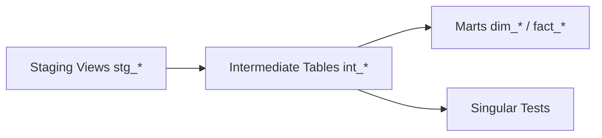

# Camada Intermediate

## Objetivo

A camada Intermediate consolida as regras de limpeza e validação que não pertencem à Staging nem aos marts finais. Ela transforma as views de staging em tabelas com lógica de negócio intermediária, mantendo o grão original quando possível.

## Visão Geral

A implementação atual possui 24 models `int_*`, todos em `src/dbt/models/intermediate/` e materializados como `table` no schema `silver`.

Esses models consomem a camada Staging e servem de base para a camada Marts e para os testes singulares em `src/dbt/tests/`.

**Nota:** A tabela `fiscal_invoices` (extraída na Bronze) não possui modelo intermediate, pois não integra o modelo dimensional atual.

## Arquitetura



## Fluxo

1. Os models `int_*` leem os dados já organizados da Staging.
2. São aplicadas limpezas, padronizações, deduplicações e enriquecimentos.
3. Regras de integridade e coerência são registradas nos arquivos `.yml` e nos testes singulares `.sql`.
4. A saída alimenta os marts dimensionais e analíticos.

## Componentes

- `src/dbt/models/intermediate/int_*.sql`: models intermediários por domínio.
- `src/dbt/models/intermediate/int_*.yml`: contratos de colunas e testes genéricos.
- `src/dbt/tests/*.sql`: testes singulares que reforçam regras de negócio.
- `dbt_project.yml`: define `intermediate` como `table` no schema `silver`.

## Dependências

- Camada Staging materializada e atualizada.
- `profiles.yml` apontando para o catálogo correto.
- Pacote `dbt_utils` quando testes ou expressões reutilizáveis dependem dele.

## Configuração

Os models de intermediate podem ser executados isoladamente durante manutenção ou validação:

```bash
source .env
dbt run --select intermediate
dbt test --select intermediate
```

## Exemplos

```sql
WITH source AS (
    SELECT *
    FROM {{ ref('stg_customers') }}
)
SELECT
    customer_id AS nk_customer_id
    , legal_name
    , is_active
FROM source
```

## Observações

- Não existe um arquivo consolidado `intermediate.yml`; os contratos ficam próximos de cada model.
- Esta camada é o ponto mais adequado para aplicar validações transacionais e ajustes de qualidade de dados.

## Referências

- [Configuração do dbt](dbt_configuration.md)
- [Camada Staging](staging.md)
- [README do projeto](../README.md)