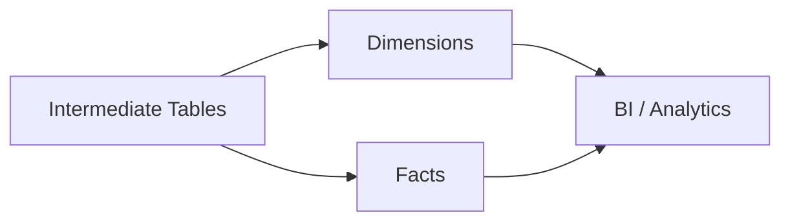

# Camada Marts

## Objetivo

A camada Marts entrega o modelo analítico final do projeto LH Nautical. Ela consolida dimensões e fatos prontos para BI, exploração e validação operacional.

## Visão Geral

A implementação atual possui 12 models no schema `gold`:

- `dim_date`
- `dim_customers`
- `dim_employees`
- `dim_locations`
- `dim_products`
- `dim_suppliers`
- `fact_order_items`
- `fact_payments`
- `fact_purchase_order_items`
- `fact_goods_receipt_items`
- `fact_stock_movements`
- `fact_return_items`

## Arquitetura



## Fluxo

1. Os models `dim_*` e `fact_*` leem a camada `int_*`.
2. As dimensões recebem chaves substitutas com prefixo `sk_`.
3. As fatos preservam o grão transacional e ligam os eventos de negócio às dimensões.
4. Os testes genéricos e singulares reforçam o contrato do modelo.

## Componentes

- `src/dbt/models/marts/*.sql`: implementação dos marts.
- `src/dbt/models/marts/*.yml`: contratos de colunas e testes genéricos.
- `src/dbt/tests/*.sql`: testes singulares de consistência e regras de negócio.

## Dependências

- Camada Intermediate atualizada.
- `dbt_project.yml` com `marts` materializado como `table` no schema `gold`.
- Macros `generate_schema_name` e `sk_from_keys` quando aplicáveis.

## Configuração

```bash
source .env
dbt run --select marts
dbt test --select marts
```

## Exemplos

```sql
WITH source AS (
    SELECT *
    FROM {{ ref('int_customers') }}
)
SELECT
    customer_id AS nk_customer_id
    , legal_name
FROM source
```

## Observações

- Não existe um arquivo consolidado `marts.yml`; cada model tem seu próprio contrato YAML.
- A camada segue um star schema com 6 dimensões e 6 fatos.

## Referências

- [Star Schema](star_schema.md)
- [Estratégia de testes](marts_tests.md)
- [Camada Intermediate](intermediate.md)
- [README do projeto](../README.md)