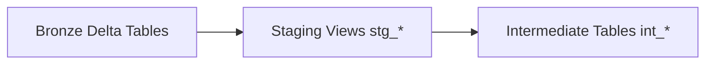

# Camada Staging

## Objetivo

A camada Staging organiza os dados brutos do Bronze em views padronizadas para consumo pelo restante do dbt. Ela não faz cálculos de negócio; o foco é limpar nomes, tipar colunas e expor um contrato estável para a camada Intermediate.

## Visão Geral

A implementação atual possui 24 models `stg_*`, todos em `src/dbt/models/staging/` e materializados como `view` no schema `silver`.

As fontes vêm da camada Bronze declarada em `src/dbt/models/staging/sources.yml`, que aponta para o schema `bronze` do catálogo ativo.

## Arquitetura



## Fluxo

1. O Bronze recebe tabelas Delta vindas do SQL Server e da API PTAX.
2. Cada `stg_*` lê uma tabela fonte via `source('bronze', ...)`.
3. O model normaliza nomes, tipos e campos de controle.
4. A saída vira base para os models `int_*`.

## Componentes

- `src/dbt/models/staging/sources.yml`: declara as 24 tabelas Bronze.
- `src/dbt/models/staging/stg_*.sql`: models de staging por domínio.
- `src/dbt/models/staging/stg_*.yml`: contratos de colunas e testes genéricos.
- `dbt_project.yml`: define `staging` como `view` no schema `silver`.

## Dependências

- Bronze já carregado em `dev_lh_nautical.bronze` ou `prod_lh_nautical.bronze`.
- `profiles.yml` configurado para o target ativo.
- `dbt_utils` disponível via `packages.yml` quando algum model usa utilitários do pacote.

## Configuração

Os models de staging são executados com o grupo `staging` do dbt:

```bash
source .env
dbt run --select staging
dbt test --select staging
```

## Exemplos

```sql
WITH source AS (
    SELECT *
    FROM {{ source('bronze', 'customers') }}
)
SELECT
    id AS customer_id
    , legal_name
    , email
FROM source
```

## Observações

- Não existe um arquivo consolidado `staging.yml`; os contratos vivem ao lado de cada model.
- A camada não deve aplicar regras analíticas finais nem agregações.

## Referências

- [Configuração do dbt](dbt_configuration.md)
- [Camada Intermediate](intermediate.md)
- [README do projeto](../README.md)