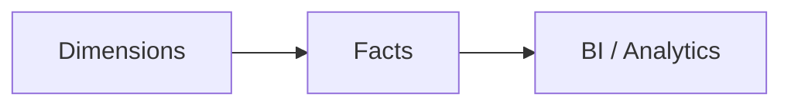

# Modelo Dimensional (Star Schema)

## Visão Geral

O modelo dimensional atual segue o padrão Star Schema com 6 dimensões e 6 fatos. As dimensões usam chaves substitutas com prefixo `sk_` e as fatos preservam o grão transacional para análises em BI.

## Dimensões

- `dim_date`
- `dim_customers`
- `dim_employees`
- `dim_locations`
- `dim_products`
- `dim_suppliers`

## Fatos

- `fact_order_items`
- `fact_payments`
- `fact_purchase_order_items`
- `fact_goods_receipt_items`
- `fact_stock_movements`
- `fact_return_items`

## Arquitetura



## Fluxo

1. As dimensões são montadas a partir da camada Intermediate.
2. As fatos ligam as entidades operacionais às dimensões conformadas.
3. O consumo analítico é feito sobre as tabelas `gold`.

## Componentes

- `src/dbt/models/marts/*.sql`: implementação das dimensões e fatos.
- `src/dbt/models/marts/*.yml`: contratos de colunas e testes genéricos.
- `src/dbt/tests/*.sql`: regras de consistência da camada analítica.

## Dependências

- Camada Intermediate atualizada.
- `dbt_project.yml` com `marts` em `gold`.
- Macros de geração de chaves quando aplicável.

## Configuração

```bash
source .env
dbt run --select marts
dbt test --select marts
```

## Exemplos

```sql
SELECT
    sk_customer
    , legal_name
    , country
FROM {{ ref('dim_customers') }}
```

## Observações

- O modelo é estável em 6 dimensões e 6 fatos; essa é a contagem refletida no código atual.
- Os detalhes finos de colunas ficam nos YAMLs de cada model.

## Referências

- [Camada Marts](marts.md)
- [Estratégia de testes](marts_tests.md)
- [README do projeto](../README.md)